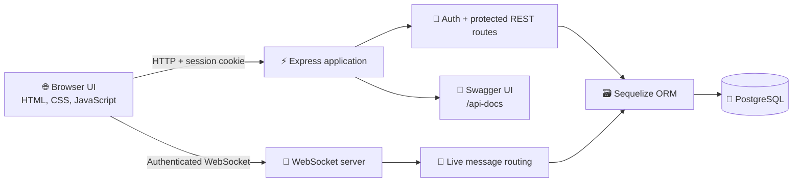

# 💬 Real-Time Chat Application

<p align="center">
  <strong>Chat clearly. Connect instantly.</strong><br />
  A full-stack real-time messaging application built with Node.js, TypeScript, Express, PostgreSQL, Sequelize, and WebSockets.
</p>

<p align="center">
  
  
  
  
</p>

<p align="center">
  <a href="#-features">Features</a> ·
  <a href="#-quick-start">Quick start</a> ·
  <a href="#-api-reference">API</a> ·
  <a href="#-websocket-reference">WebSocket</a> ·
  <a href="#-project-structure">Structure</a>
</p>

## ✨ Features

- 🔐 Register, log in, and log out with server-side sessions stored in PostgreSQL.
- 💬 One-to-one private messaging over an authenticated WebSocket connection.
- 👥 Create, search, join, and leave group chat rooms.
- 📨 Persist private and group messages in PostgreSQL.
- 🕘 Load conversation history with pagination.
- 🔎 Search for people and groups from the chat screen.
- 🟢 Online presence updates and live room membership notifications.
- ⌨️ Typing and stop-typing indicators.
- 🧹 Delete private messages sent by the authenticated user.
- 🩺 Health endpoint for server and database availability.
- 📚 Interactive Swagger UI at `/api-docs`.
- 🖥️ Responsive static frontend served by the same Express server.
- ✅ Runtime validation with Zod, password hashing with bcrypt, and strict TypeScript checking.

## 🖼️ How it works



The browser uses the same origin for both transports:

1. Register or log in through the REST API.
2. The server creates a session and returns an HTTP-only `connect.sid` cookie.
3. The chat page opens a WebSocket using that session cookie.
4. REST loads conversations and history; WebSocket delivers live events.

## 🧰 Technology stack

| Layer               | Technology                                             |
| ------------------- | ------------------------------------------------------ |
| Runtime             | Node.js                                                |
| Language            | TypeScript 5.9                                         |
| HTTP server         | Express 5                                              |
| Real-time transport | `ws` WebSocket server                                  |
| Database            | PostgreSQL                                             |
| ORM and migrations  | Sequelize 6, Sequelize CLI                             |
| Authentication      | `express-session`, `connect-session-sequelize`, bcrypt |
| Validation          | Zod                                                    |
| API documentation   | Swagger UI Express and OpenAPI YAML                    |
| Frontend            | Semantic HTML, CSS, and browser JavaScript             |
| Quality tools       | ESLint, Prettier, Husky, lint-staged                   |

## 🚀 Quick start

### Prerequisites

- Node.js 20 or newer
- npm
- PostgreSQL 14 or newer

### 1. Clone and install

```bash
git clone https://github.com/updpujan/Real-Time-Chat-Application.git
cd Real-Time-Chat-Application
npm install
```

### 2. Create a PostgreSQL database

Create a database and a user with permission to create tables. For example:

```sql
CREATE USER chat_user WITH PASSWORD 'change-this-password';
CREATE DATABASE chat_application OWNER chat_user;
```

### 3. Configure environment variables

Copy the example file and replace every placeholder:

```bash
cp .env.example .env
```

| Variable         | Required | Description                         | Example                        |
| ---------------- | -------- | ----------------------------------- | ------------------------------ |
| `PORT`           | Yes      | HTTP and WebSocket server port      | `3000`                         |
| `NODE_ENV`       | Yes      | Runtime environment                 | `development`                  |
| `DB_HOST`        | Yes      | PostgreSQL host                     | `localhost`                    |
| `DB_PORT`        | Yes      | PostgreSQL port                     | `5432`                         |
| `DB_USER`        | Yes      | PostgreSQL username                 | `chat_user`                    |
| `DB_PASSWORD`    | Yes      | PostgreSQL password                 | `change-this-password`         |
| `DB_NAME`        | Yes      | PostgreSQL database name            | `chat_application`             |
| `SESSION_SECRET` | Yes      | Long, random session signing secret | `replace-with-a-random-secret` |

`src/config/database.ts` fails fast when database variables are missing. Keep `.env` local and never commit credentials.

### 4. Run migrations

```bash
npm run migration:status
npm run migration:run
```

The migrations create users, sessions, rooms, room membership, and messages tables.

### 5. Start the application

For development, with automatic TypeScript reloads:

```bash
npm run dev
```

For a production-style build:

```bash
npm run build
npm run migration:run:prod
npm start
```

Open [http://localhost:3000](http://localhost:3000), create an account, and log in. The application serves the landing page, authentication pages, and chat UI directly from the `frontend/` directory.

## 🧭 Useful URLs

| URL                   | Purpose                                   | Authentication   |
| --------------------- | ----------------------------------------- | ---------------- |
| `/`                   | Landing page                              | Public           |
| `/register.html`      | Create an account                         | Public           |
| `/login.html`         | Sign in                                   | Public           |
| `/chat.html`          | Chat workspace                            | Session required |
| `/health`             | Server and database health check          | Public           |
| `/api-docs`           | Interactive OpenAPI/Swagger documentation | Public           |
| `ws://localhost:3000` | Authenticated WebSocket endpoint          | Session required |

Check the service from a terminal:

```bash
curl http://localhost:3000/health
```

Expected healthy response:

```json
{
  "status": "healthy",
  "server": "up",
  "database": "up"
}
```

## 📡 API reference

All `/chat` routes require the session cookie created by `/auth/login`. The complete request and response schemas are available in [Swagger UI](http://localhost:3000/api-docs) and [swagger.yaml](./src/docs/swagger.yaml).

### Authentication

| Method | Endpoint         | Description                                        |
| ------ | ---------------- | -------------------------------------------------- |
| `POST` | `/auth/register` | Create a user with `name`, `email`, and `password` |
| `POST` | `/auth/login`    | Authenticate and create a session                  |
| `POST` | `/auth/logout`   | Destroy the current session                        |

Registration accepts a name of 2–100 characters, an email address, and a password of 8–20 characters. The browser form also requires uppercase, lowercase, a number, and a special character.

Example:

```bash
curl -i -c cookies.txt \
  -H "Content-Type: application/json" \
  -d '{"email":"you@example.com","password":"SecurePass1!","name":"Your Name"}' \
  http://localhost:3000/auth/register

curl -i -c cookies.txt -b cookies.txt \
  -H "Content-Type: application/json" \
  -d '{"email":"you@example.com","password":"SecurePass1!"}' \
  http://localhost:3000/auth/login
```

### Conversations and rooms

| Method   | Endpoint                            | Description                                         |
| -------- | ----------------------------------- | --------------------------------------------------- |
| `GET`    | `/chat/conversation`                | List the current user's conversations               |
| `GET`    | `/chat/conversation/:type/:id`      | Get `private` or `group` history                    |
| `GET`    | `/chat/searchConversation?q=term`   | Search people and groups                            |
| `POST`   | `/chat/createRoom`                  | Create a room with `name` and optional `maxMembers` |
| `POST`   | `/chat/joinRoom/:roomId`            | Join a room                                         |
| `DELETE` | `/chat/leaveRoom/:roomId/member/me` | Leave a room                                        |
| `GET`    | `/chat/allRooms`                    | List rooms for the current user                     |
| `DELETE` | `/chat/deleteMessage/:messId`       | Delete a private message sent by the current user   |

History supports `limit` (1–100, default `20`) and `offset` (default `0`). Room capacity defaults to 50 and may be set from 2 to 50 members.

## 🔌 WebSocket reference

Connect after logging in. The session cookie is used during the WebSocket upgrade:

```js
const socket = new WebSocket(`ws://${window.location.host}`);
```

Messages use this envelope:

```json
{
  "type": "event_name",
  "data": {}
}
```

### Client-to-server events

| Event             | Data                                       | Description                            |
| ----------------- | ------------------------------------------ | -------------------------------------- |
| `private_message` | `{ "receiverId": 2, "content": "Hello!" }` | Save and deliver a private message     |
| `room_message`    | `{ "roomId": 1, "content": "Welcome!" }`   | Save and broadcast a room message      |
| `typing`          | `{ "receiverId": 2 }`                      | Notify a private-chat recipient        |
| `stop_typing`     | `{ "receiverId": 2 }`                      | Clear the recipient's typing indicator |

Example:

```js
socket.send(
  JSON.stringify({
    type: 'private_message',
    data: { receiverId: 2, content: 'Hello in real time!' },
  }),
);
```

### Server-to-client events

`private_message`, `private_message_saved`, `room_message`, `room_message_saved`, `typing`, `stop_typing`, `online_users`, `user_online`, `user_offline`, `room_member_joined`, `room_member_left`, and `error`.

Messages are validated before persistence. Private message content is limited to 1–1,000 characters by the current schema; room message content is limited to 1–5,000 characters.

## 🛠️ npm scripts

| Command                         | Purpose                                     |
| ------------------------------- | ------------------------------------------- |
| `npm run dev`                   | Run the development server with `tsx watch` |
| `npm run build`                 | Compile TypeScript from `src/` into `dist/` |
| `npm start`                     | Start the compiled server                   |
| `npm run lint`                  | Run ESLint                                  |
| `npm run lint:fix`              | Fix supported ESLint issues                 |
| `npm run format`                | Format project files with Prettier          |
| `npm run format:check`          | Verify Prettier formatting                  |
| `npm run migration:status`      | Show local migration status                 |
| `npm run migration:run`         | Apply source migrations                     |
| `npm run migration:revert`      | Revert the latest source migration          |
| `npm run migration:status:prod` | Show compiled migration status              |
| `npm run migration:run:prod`    | Apply compiled migrations                   |
| `npm run migration:revert:prod` | Revert the latest compiled migration        |

Before opening a pull request, run:

```bash
npm run build
npm run lint
npm run format:check
```

## 📁 Project structure

```text
.
├── frontend/             # Static landing, auth, chat pages, styles, and browser JS
├── src/
│   ├── config/           # Database, session, and Swagger configuration
│   ├── controller/       # HTTP request handlers
│   ├── docs/             # OpenAPI specification
│   ├── middleware/       # Authentication, validation, and error handling
│   ├── migrations/       # Sequelize database migrations
│   ├── models/           # Sequelize models and associations
│   ├── repository/       # Database access helpers
│   ├── routes/           # Health, auth, and chat routes
│   ├── schema/           # Zod request and WebSocket schemas
│   ├── service/          # Authentication, room, chat, and message logic
│   └── websocket/        # Upgrade authentication, routing, presence, and rooms
├── config/               # Sequelize CLI configuration
├── scripts/              # Local Sequelize CLI wrapper
├── dist/                 # Generated TypeScript build output
├── .env.example          # Environment variable template
└── package.json          # Scripts and dependencies
```


## 🔗 Links

- [Repository](https://github.com/updpujan/Real-Time-Chat-Application)
- [OpenAPI specification](./src/docs/swagger.yaml)
